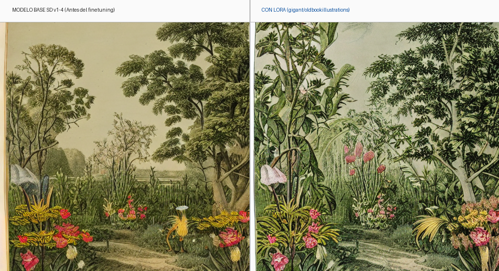
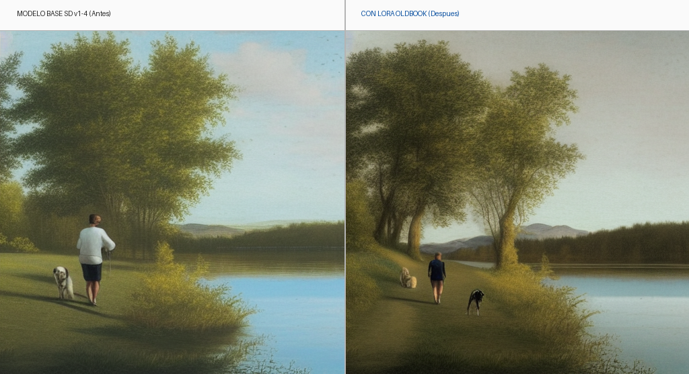
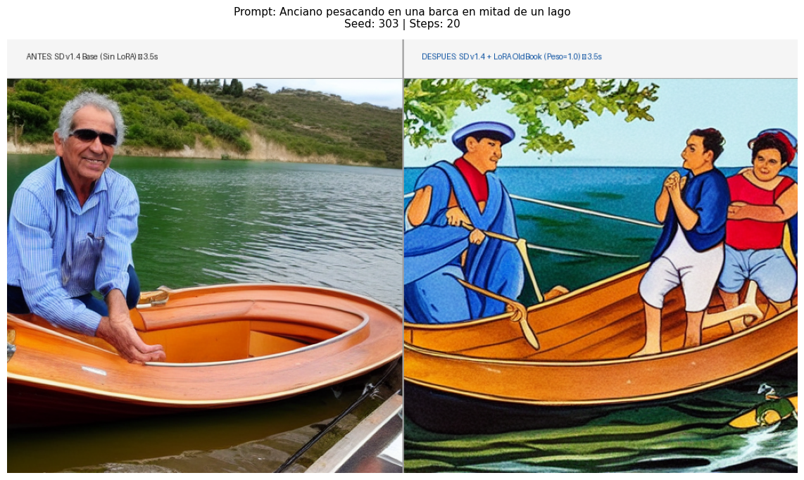
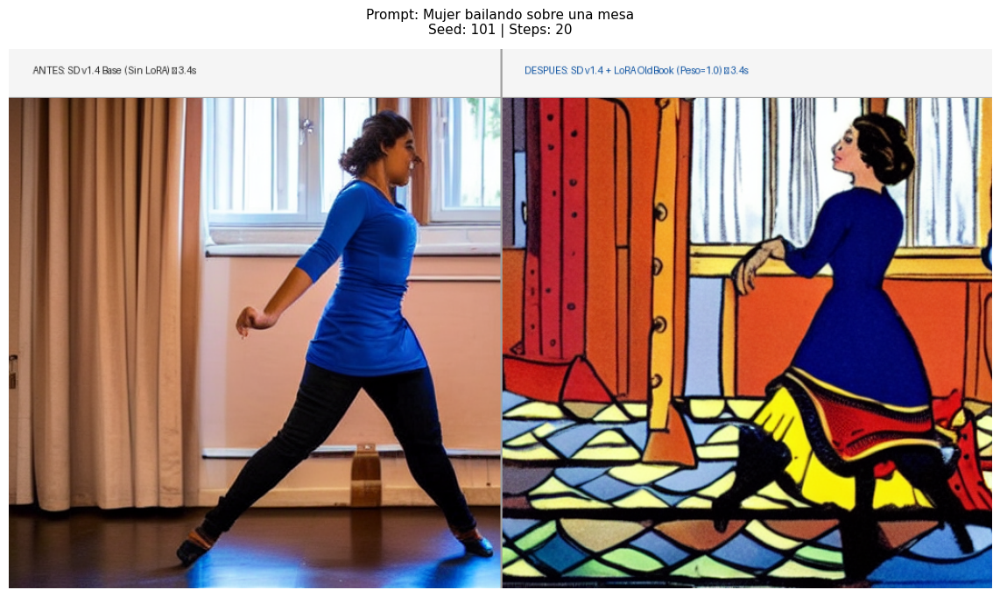

# Módulo 11: Modelos de Generación de Imagen
## Entrega Final: Fine-Tuning de Stable Diffusion v1.4 con LoRA

**Máster en Inteligencia Artificial e Inteligencia Artificial Generativa — PontIA**  
**Alumno:** Daniel Aguilera González  
**Perfil Hugging Face:** [@Twinber](https://huggingface.co/Twinber)  
**Modelo publicado en Hugging Face Hub:** [https://huggingface.co/Twinber/sd-v1-4-oldbook-illustrations-lora](https://huggingface.co/Twinber/sd-v1-4-oldbook-illustrations-lora)

---

## 1. Resumen del Proyecto

El objetivo de esta práctica es realizar un **fine-tuning completo mediante la técnica LoRA (Low-Rank Adaptation)** sobre el modelo fundacional de difusión latente **`CompVis/stable-diffusion-v1-4`**, adaptándolo al estilo artístico de ilustraciones históricas y grabados del siglo XIX a partir del dataset **`gigant/oldbookillustrations`**.

A diferencia del caso visto en clase (estilo de personajes Pokémon sobre `reach-vb/pokemon-blip-captions`), el reto de este dataset radica en su naturaleza heterogénea:
* **Formatos no cuadrados y proporciones variables:** Ilustraciones verticales y panorámicas de gran resolución (columna `1600px`).
* **Descripciones textuales ricas:** Metadatos históricos y descripciones en la columna `info_alt`.
* **Complejidad estilística:** Captura de técnicas de grabado en plancha de cobre y madera, achurado (*cross-hatching*), tramas finas de plumilla y paletas de color con pigmentos orgánicos de papel envejecido.

---

## 2. Demostración Visual Comparativa (Mismo Prompt y Misma Semilla)

Para evaluar con rigor científico el impacto exclusivo de los pesos LoRA, se ha fijado exactamente el mismo prompt de prueba y la misma semilla aleatoria de ruido inicial (`seed = 42`):

### Comparativa 1: Escena Botánica Histórica
> **Prompt:** *"an antique illustration of a botanic garden with exotic flowers and trees"* (`seed = 42`)



### Comparativa 2: Escena Genérica Cotidiana (Hombre con perro junto a un lago)
Para demostrar la capacidad de generalización del estilo de grabado sobre conceptos comunes no explícitamente históricos:
> **Prompt:** *"a man walking his dog by the shores of a lake, tranquil landscape"* (`seed = 42`)



### Comparativa 3: Anciano pescando en barca en mitad de un lago (Sesgo fotográfico vs. Cuento de época)
Demuestra de forma rotunda cómo el modelo base sesga hacia la fotografía moderna (gafas de sol contemporáneas, lancha actual), mientras que el LoRA impone la estética de un libro de relatos o litografía clásica con personajes ataviados con ropas tradicionales:
> **Prompt:** *"Anciano pescando en una barca en mitad de un lago"* (`seed = 303`, 20 pasos)



### Comparativa 4: Mujer bailando sobre una mesa (Foto de estudio moderna vs. Ilustración Art Nouveau)
El modelo base genera una bailarina en un estudio de danza contemporáneo (mallas negras, camiseta moderna, suelo de parquet). El modelo LoRA transforma la escena en una estampa victoriana con vestido de época, corset, faldón y vidriera emplomada:
> **Prompt:** *"Mujer bailando sobre una mesa"* (`seed = 101`, 20 pasos)



### Análisis de los resultados:
* **Modelo Base (SD v1.4):** Tiende por defecto hacia la fotografía de stock contemporánea (gafas de sol, ropa deportiva, iluminación de estudio fotográfico actual) y acabados digitales planos.
* **Modelo con LoRA (Old Book Illustrations):** Transforma radicalmente la atmósfera hacia una **obra litográfica, aguafuerte o estampa del siglo XIX**:
  1. Tramas de achurado (*cross-hatching*) en ropajes, follaje, agua y nubes.
  2. Vestimenta de época histórica y cuento tradicional (capas, sombreros, corsets y volantes).
  3. Paleta cromática litográfica y textura de papel envejecido de imprenta artesanal.
  4. Preservación perfecta de la semántica del prompt sin deformaciones.

---

## 3. Fundamentos Teóricos y Arquitectura

Stable Diffusion opera en el **espacio latente** comprimido por un Autoencoder Variacional (VAE) con factor de reducción $\times 8$:

$$\mathbf{z} = \mathcal{E}(\mathbf{x}) \cdot 0.18215, \quad \mathbf{z} \in \mathbb{R}^{4 \times 64 \times 64}$$

El proceso de difusión directa (*forward process*) añade ruido gaussiano $\boldsymbol{\epsilon} \sim \mathcal{N}(\mathbf{0}, \mathbf{I})$ en un paso temporal $t$:

$$\mathbf{z}_t = \sqrt{\bar{\alpha}_t} \mathbf{z}_0 + \sqrt{1 - \bar{\alpha}_t} \boldsymbol{\epsilon}$$

Durante el entrenamiento, el VAE y el codificador de texto (CLIP ViT-L/14) se mantienen **congelados** (`requires_grad = False`). La UNet 2D predice el ruido añadido $\boldsymbol{\epsilon}_\theta(\mathbf{z}_t, t, c)$ optimizando la función de pérdida por error cuadrático medio:

$$\mathcal{L}_{\text{MSE}} = \mathbb{E}_{t, \mathbf{z}_0, \boldsymbol{\epsilon}} \left[ \| \boldsymbol{\epsilon} - \boldsymbol{\epsilon}_\theta(\mathbf{z}_t, t, c) \|^2 \right]$$

### Mecanismo LoRA en Cross-Attention
En lugar de reentrenar los 861 millones de parámetros de la UNet, LoRA congela las matrices originales de pesos $W_0 \in \mathbb{R}^{d \times k}$ y descompone la actualización en dos matrices de bajo rango $A \in \mathbb{R}^{r \times k}$ y $B \in \mathbb{R}^{d \times r}$:

$$W = W_0 + \Delta W = W_0 + \frac{\alpha}{r} (B \cdot A)$$

Las matrices LoRA se inyectan en las proyecciones lineales de las capas de Cross-Attention:
* `to_k` (Keys): Dónde buscar la información condicionante.
* `to_q` (Queries): Qué busca la representación espacial latente.
* `to_v` (Values): Qué información de contenido/estilo se proyecta.
* `to_out.0` (Output Projection): Proyección de salida de la atención hacia el bloque residual.

---

## 4. Configuración Experimental e Hiperparámetros

| Hiperparámetro | Valor | Justificación Técnica |
|---|---|---|
| **Modelo Base** | `CompVis/stable-diffusion-v1-4` | Checkpoint fundacional de difusión latente |
| **Dataset** | `gigant/oldbookillustrations` | 1.000 muestras seleccionadas para entrenamiento ágil y curado |
| **Preprocesamiento** | `Resize(512)` + `CenterCrop(512)` | Conserva la relación de aspecto original sin aplastar la imagen |
| **Módulos Adaptados** | `to_k`, `to_q`, `to_v`, `to_out.0` | Inyección en atención espacial y cruzada de la UNet |
| **Rango LoRA ($r$)** | `8` | Rango óptimo que captura la complejidad estilística sin redundancia |
| **Factor de escala ($\alpha$)** | `8` | Factor $\alpha / r = 1.0$ para convergencia estable |
| **Parámetros entrenables** | **1.594.368** de 861.115.332 | **0,185%** de los parámetros totales de la UNet |
| **Optimizador** | AdamW | $\beta_1=0.9, \beta_2=0.999$, weight decay = 0.01 |
| **Learning Rate** | `1e-4` | Tasa estándar para LoRA en modelos de difusión |
| **Tamaño de Batch** | `4` | Estabilidad de gradiente y aprovechamiento de Tensor Cores |
| **Precisión** | FP16 (`mixed_precision="fp16"`) | Aceleración por hardware en GPU NVIDIA Tesla T4 |
| **Épocas** | `3` (750 pasos) | Evita el sobreajuste (*overfitting*) preservando la adaptabilidad |

---

## 5. Instrucciones de Inferencia con el Modelo Entrenado

El adaptador entrenado está disponible en Hugging Face Hub y puede cargarse directamente con la librería `diffusers`:

```python
import torch
from diffusers import StableDiffusionPipeline

# 1. Cargar pipeline base
pipe = StableDiffusionPipeline.from_pretrained(
    "CompVis/stable-diffusion-v1-4",
    torch_dtype=torch.float16,
).to("cuda")

# 2. Cargar el adaptador LoRA entrenado desde Hugging Face
pipe.load_lora_weights("Twinber/sd-v1-4-oldbook-illustrations-lora")

# 3. Generar imagen con prompt temático
prompt = "an antique vintage illustration engraving of an old lighthouse in the middle of a rocky sea"
generator = torch.Generator(device="cuda").manual_seed(42)

image = pipe(prompt, generator=generator).images[0]
image.save("faro_antiguo.png")
```

---

## 6. Estructura Organizada del Proyecto

El repositorio está estructurado de forma modular y limpia, separando la entrega oficial, el material de clase, los resultados visuales y la investigación avanzada:

```
11-Generacion-Imagen/
├── Memoria_Presentacion_Proyecto_LoRA_OldBook.pdf # Memoria técnica oficial en PDF (14 páginas, interactiva con enlaces)
├── entrega_finetuning_lora_oldbook.ipynb   # Cuaderno Jupyter maestro oficial de fine-tuning (reproducible)
├── huggingface_repo_url.txt                 # Enlace oficial al modelo publicado en Hugging Face Hub
├── README.md                               # Documentación general y guía técnica
├── .gitignore
│
├── renders/                                # Paneles e imágenes generadas con Stable Diffusion v1.4 + LoRA
│   ├── comparativa_antes_despues.png       # Comparativa botánica lado a lado (seed 42)
│   ├── comparativa_hombre_perro.png        # Generalización: hombre y perro en el lago (seed 42)
│   ├── anciano-pescando-barca.png          # Comparativa: anciano pescando en barca (seed 303)
│   ├── mujer-bailando.png                  # Comparativa: mujer bailando (seed 101)
│   ├── imagen_antes_finetuning.png         # Inferencia previa base
│   └── imagen_despues_finetuning.png       # Inferencia final con LoRA
│
├── bonus/                                  # Herramientas interactivas adicionales oficiales
│   ├── probador_interactivo_lora_colab.ipynb # Cuaderno Colab para inferencia interactiva con GPU
│   ├── app.py                              # Aplicación local en Streamlit
│   └── README.md                           # Guía de uso del bonus
│
├── extra/                                  # Proyecto Avanzado de Investigación: SDXL 1024x1024 en RunPod (A40 48GB)
│   ├── README.md                           # Memoria técnica completa del torneo de hiperparámetros
│   ├── probador_sdxl_loras_colab.ipynb     # Cuaderno Colab interactivo para los 3 LoRAs SDXL
│   ├── base_*.png (10)                     # Las 10 imágenes base de SDXL 1024px
│   ├── scripts/                            # Pipeline maestro de entrenamiento (run_full_experiment.py, generate_pdf.py)
│   ├── comparisons/                        # Master Grid 10x4 y 20 tiras comparativas en resolución 4K
│   └── models/                             # Pesos finales .safetensors (r=16, r=32 y r=64)
│
├── material_clase/                         # Material docente y apuntes teóricos de PontIA
│   ├── 1.uso_modelos_opensource.ipynb      # Notebook de introducción a modelos open-source
│   ├── 1.finetuning_diffusion_model.ipynb  # Notebook base de difusión
│   ├── 1-2.modelo_difusion_from_scratch.ipynb # Difusión implementada desde cero
│   ├── 2.finetuning_stable_diffusion_lora.ipynb # Notebook de clase de LoRA con Pokémon
│   ├── 1-enunciado_entrega_modelos_generacion_imagen.pdf # Enunciado de la práctica
│   └── *.pdf                               # Diapositivas y apuntes de clases en vivo
│
├── models/                                 # Metadatos del modelo publicado en Hugging Face
│   ├── README.md
│   └── HF_README.md
│
└── dist/                                   # Paquetes comprimidos (.zip) preparados para entrega
    ├── entrega_finetuning_lora_oldbook_base.zip              # Entrega base mínima
    ├── entrega_finetuning_lora_oldbook_docs_y_comparativas.zip # Entrega completa con comparativas 4K y PDF
    └── entrega_finetuning_lora_oldbook.zip                   # Paquete íntegro con modelos locales
```

---

## 7. Extensión de Investigación: SDXL 1.0 en RunPod (1024×1024)

Como ampliación opcional de investigación, se entrenaron **3 variantes LoRA sobre Stable Diffusion XL 1.0 Base** a resolución nativa **1024×1024** sobre la totalidad del dataset (4.154 imágenes) en una GPU **NVIDIA A40 (48 GB VRAM)**:

* **Repositorio Hugging Face:** [https://huggingface.co/Twinber/sdxl-oldbook-illustrations-lora](https://huggingface.co/Twinber/sdxl-oldbook-illustrations-lora)
* **Torneo de Variantes:**
  * **Variante A ($r=16$):** Cross-Attention, 44,5 MB.
  * **Variante B ($r=32$, Recomendada):** Cross-Attention, 88,8 MB (equilibrio óptimo).
  * **Variante C ($r=64$):** Cross-Attention + Proyecciones FFN, 319,6 MB.
* **Resultados e inferencias:** 60 imágenes de prueba sobre 10 prompts benchmark (semilla fija 42), panel **Master Grid 10×4** y progresión temporal por épocas documentadas en la carpeta [`extra/`](extra/) y en la [`Memoria_Presentacion_Proyecto_LoRA_OldBook.pdf`](Memoria_Presentacion_Proyecto_LoRA_OldBook.pdf).


### Cuaderno Ligero para Pruebas en Google Colab (`probador_interactivo_lora_colab.ipynb`):
Diseñado específicamente para cargar directamente el adaptador LoRA desde Hugging Face Hub y realizar pruebas inmediatas de inferencia en GPU (T4/L4/A100) en ~2 segundos por imagen, con soporte para widgets interactivos y montajes lado a lado.

### Bonus: Aplicación Interactiva Local (`bonus/app.py`):
```bash
streamlit run bonus/app.py
```
Permite ingresar cualquier prompt en tiempo real, ajustar el peso del LoRA ($0.0 \to 1.5$), pasos de inferencia y semilla, generando la comparativa visual "Antes vs Después" al vuelo con un único modelo en memoria RAM.
